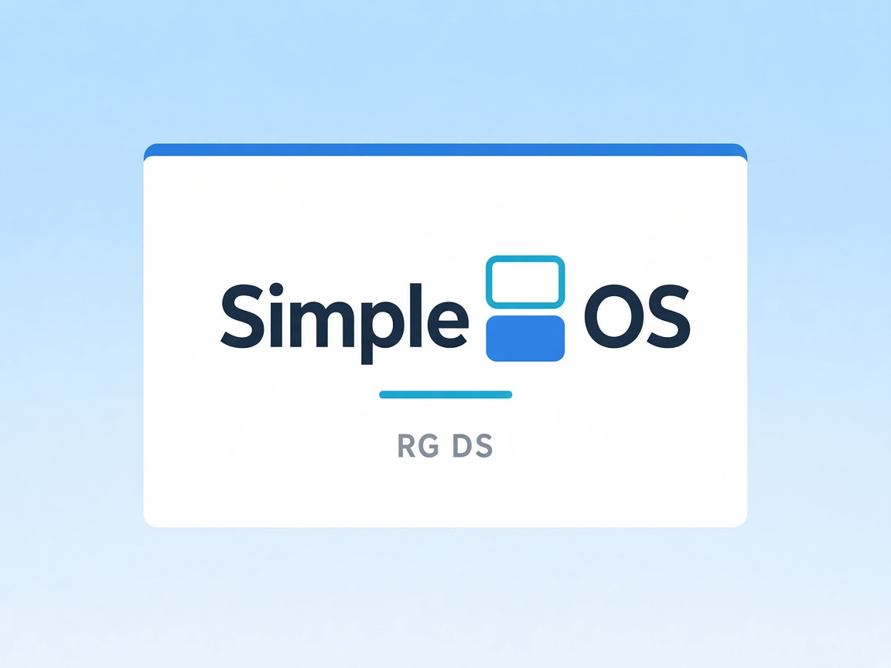

# Installing SimpleOS on Anbernic RG DS

  

## What you need
The release zip `releases/SimpleOS-RGDS-YYYYMMDD.zip` from this repository.

## Install
1. Download the `SimpleOS-RGDS-YYYYMMDD.img` file from the latest release of SimpleOS
2. Extract the `.zip` file onto your pc. it contains the `.img`file you'll have to flash on your SD card 
3. Put an SD card into your computer and flash the `.img` onto the SD card
4. Extract the SD card from your PC and put it into the TF card slot of your RG DS
5. Turn on the console: you will see Anbernic's boot logos, and then the install process should start. The console will reboot a few times, let it finish
6. One you are prompted to "touch the touch screen to continue" you can turn off your console and add your games to the SD card
7. Enjoy
Games go in `simpleos/games` and/or the folder (`roms/nds`) on the roms partition .

## Update
**If you have WiFi access on your device**🛜
1. Turn on WiFi connection from the **Network settings** on your device
2. Open the **Settings** menu and select the **Update** option
3. Select **OTA**
4. If an update is available you will be asked to install the new update
5.  You will be asked if you want to install, click **A** to accept
6.  Wait for the installation process to finish
7. The device will now reboot into the updated version of SimpleOS

**If you don't have WiFi access on your device**❌🛜
1. Download the latest update package from the release page of **SimpleOS** on [github](https://github.com/boorngos/SimpleOS/releases)
2. Turn off your console and insert the SD card inside your PC
4. Put the .zip with the latest release you download inside the *root* of the *Roms* partition of your SD card
5. Put the SD card back onto your device and power it on
6. Open the Settings menu in **SimpleOS** and click on the **Update** option
7. Click on **Manual update**
8. You will be asked if you want to install, click **A** to accept
9. Wait for the installation process to finish
10. The device will now reboot into the updated version of SimpleOS

